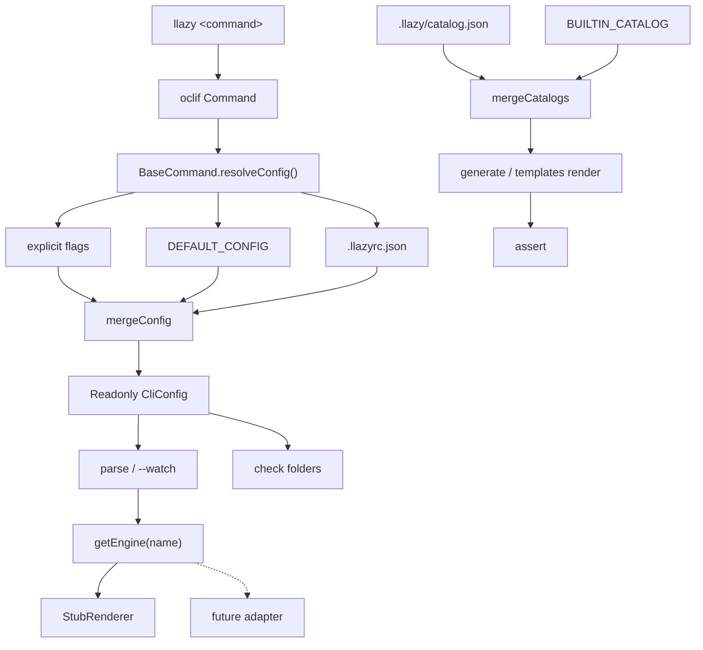

# Architecture

`@llazyemail/cli` is a thin command layer over two pipelines that share config, filesystem, and `Result<T>`.



## Layers

| Layer | Responsibility | Must not |
| --- | --- | --- |
| Commands | parse flags, print, exit | own business logic that tests need |
| Domain (`catalog`, `parse`, `engine`) | pure-ish functions returning `Result` | print, exit, read `process.argv` |
| Utils | fs, paths, config file, debounce, meta | know about oclif |
| Types | frozen config, Result | depend on Node APIs |

Commands should stay thin. If a test needs to drive a command, prefer extracting a function (see `runParseOnce`) over shelling out.

## Two products inside one CLI

1. **Parse path** — one Markdown file → one engine → one output. This is the markdown-to-email shape (`source/source.md` → `generated/newEmail.html`).
2. **Catalog path** — many named templates → sample or `--data` payload → many HTML files. This is the generate-template / Postmark shape.

They share config directories and the assert step. They do not share a renderer today. That is fine. Do not force them into one function.

## Error model

`Result<T>` is a discriminated union:

```ts
type Result<T> = {ok: true; value: T} | {ok: false; error: string; cause?: unknown}
```

- Domain functions return `Result`.
- Commands check `.ok` and call `this.error(message)` on failure.
- Unexpected throws are bugs.

## Engine registry

A `Map<string, RendererEngine>` in `src/engine/registry.ts`.

```ts
interface RendererEngine {
  readonly name: string
  render(request: RenderRequest): RenderOutput
}
```

The stub registers itself on import. A future adapter registers the same way. `parse --engine` looks up by name. Unknown name is a `Result` error, not a throw.

## Catalog

A catalog entry is data, not a class:

```ts
interface CatalogEntry {
  ids: readonly string[]          // CamelCase, first is canonical
  aliases?: readonly string[]     // kebab CLI names
  kind: 'transactional' | 'newsletter' | 'lead'
  description: string
  samplePayload: Readonly<Record<string, unknown>>
  fileName: string
}
```

Lookup is case-insensitive on ids and aliases. Project entries that share any key replace the built-in entry.

## Watch

`parse --watch` uses `fs.watch` plus `createDebouncer`. Each tick calls `runParseOnce`. There is no chokidar dependency on purpose.

## CI

`.github/workflows/ci.yml`:

```
npm install --ignore-scripts   # skip prepare
npm run build
npm test
node ./bin/run.js --help
```

There is no `package-lock.json` yet, so CI cannot use `npm ci`. That is a known gap (roadmap PR 4).

## Related repositories (not dependencies)

| Repo | What we copied as a pattern |
| --- | --- |
| [generate-template](https://github.com/LLazyEmail/generate-template) | catalog, `--all`, `--template`, sample payloads, `run` / `writeAll` |
| [postmark-transactional-template-simple](https://github.com/LLazyEmail/postmark-transactional-template-simple) | CamelCase ids, kebab aliases, transactional set |
| [email-template-workflows](https://github.com/LLazyEmail/email-template-workflows) | artifact dir, 102 KB Gmail limit |
| [markdown-to-email](https://github.com/LLazyEmail/markdown-to-email) | `#!` subject, `#~` preview, `source/source.md` |
| [markup-generator](https://github.com/LLazyEmail/markup-generator) | write-to-`generated/` |

Adapters for these belong in a later PR, behind the existing interfaces.
